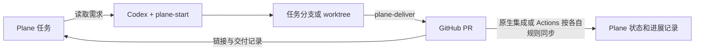

# Plane for Codex

一个社区维护的开源 Codex 插件，把 Plane 任务、开发分支、GitHub PR 和交付记录串起来。

版本更新见 [CHANGELOG.md](CHANGELOG.md)。

当前 v0.7.0 支持 **选择或创建 Plane 项目 → 关联仓库 → 配置 GitHub 后台同步 → 验证初始化**，并支持检查、安全重新配置和继续未完成的配置。每个仓库有自己的映射，支持个人账号和组织仓库。Python 脚本只使用标准库；无需部署服务。完整目标见 [工作流方案](docs/workflow-plan.md)，Cycle、任务创建和上下文自动推进尚未实现。

## 基本使用

在目标代码仓库的 Codex 聊天中，打开你当前版本的技能选择菜单，搜索 **Plane**，选择 **Plane: 初始化** 并发送即可，无需再输入“初始化”或配置文字。

如果你的版本在 `/` 菜单中展示技能，输入 `/` 后搜索 Plane；其他客户端可通过技能菜单或 `$` 选择 Skill。这里接入的是 Codex 原生的技能选择器，具体打开方式由客户端决定。

插件复用已有登录连接，读取工作区并让你选择 **关联已有项目** 或 **创建新项目**。仓库名只用于推荐项目，不会直接绑定。创建时预填项目名称和标识，可修改。首次未连接账号时在浏览器中授权；无需配置长提示词或查找 UUID。

已有配置时可选 **检查当前配置** 或 **重新配置**；后台同步未就绪时提供 **继续配置 GitHub 后台同步**。重配先展示差异，再核对文件摘要、备份并原子替换；取消或失败保留原配置。不会退出账号、删除 Plane 对象或改变已有任务分支。备份放在 Git 元数据目录，不随业务代码发布。

完整初始化需要验证选定的同步模式：免费用户默认使用 Actions；已经配置官方 GitHub 集成的用户可使用原生模式。原生模式无需本插件 workflow 或 PAT Secret。仅有付费套餐不代表集成已经就绪。Actions 模式中，暂时缺少凭证、权限或未将配置变更合入默认分支时，保存已有配置并报告 **部分完成**：GitHub 的 PR 事件无法自动回写 Plane，相关状态转换不会自动发生；仍可回到 Codex 检查并同步。文件已生成但尚未验证时明确报告“未验证”，不伪报配置完成。

新关联不要求状态 ID，也不新增审核状态；空项目可直接配置。新或不同项目使用基础配置 version 2，自动状态同步关闭。关联相同项目时保留旧 version 1 配置及完成规则。自定义状态规则会在后续阶段提供。

开发交付现在先整理需求与验收标准，按需确认设计，并在 Git 元数据保存可恢复的任务记录。验证、人工验收与合并授权绑定具体需求和提交；交付前执行检查，未完成的工作可发布 Draft PR。具体流程与命令见 [任务执行与验收](plugins/plane-for-codex/references/task-execution.md)。自定义状态规则仍未实现。

在已关联仓库讨论、调研或规划新需求时，先判断任务归属。纯讨论只在会话或仓库外临时文件中输出；需要将规划、调研或设计文件保存到仓库时，先从最新配置基础分支准备任务分支，再记录文件范围并运行 `write-context` 检查。新会话不自动等于新任务，当前分支也不自动代表本轮任务。文档写入与代码写入遵循同一归属检查，文档需求不会自动启动实现或修改 Plane 状态。

开发期间记录任务目录、分支、基础提交和允许修改的文件范围，恢复开发及提交前检查累计差异。确认 PR 合并和任务完成后，交付技能自动更新主 checkout：切回配置的基础分支（通常是 main），以 `--ff-only` 拉取最新代码并核对本地／远端一致。未提交改动、分支分叉和 worktree 占用会保留现场；收尾失败只重试本地步骤，任务完成状态保持不变。见 [分支检查与收尾](plugins/plane-for-codex/references/checkout.md)。

同一 Codex 项目中，不同会话可以分别处理不同 Plane 任务。新任务默认创建独立 worktree 和分支，基于刚获取的配置基础分支（通常为 `main`），不会切换其他任务或主目录的分支；再次开始同一任务会恢复原工作目录。Codex 提供受管 worktree 工具时优先使用其附件与生命周期支持；脚本也提供独立目录的兼容路径。所有工具操作都必须使用准备结果中的任务执行目录。

每个任务通过自己的 PR 合回基础分支。合并前用 `sync-task` 将最新基线合入当前任务；A 合并后如果 B 出现冲突，在 B 中解决、提交并重新验证，更新原 PR 后再合并。检查会阻止未知或尚未同步的实时 PR 基线、未解决冲突和过期验证。完成 A 时保留 B 的分支、目录与未提交改动。见 [多会话任务与冲突处理](plugins/plane-for-codex/references/parallel-tasks.md)。

三个可选择的入口如下：

| 菜单入口 | 所需输入 | 结果 |
| --- | --- | --- |
| **Plane: 初始化** | 直接选择并发送 | 关联项目、引导配置后台同步；检查、重配或继续未完成的初始化 |
| **Plane: 开始任务** | 可附任务编号/链接；未提供则引导选任务 | 先判断归属；为新任务准备独立目录/分支，恢复已有任务并检查写入范围 |
| **Plane: 交付任务** | 当前任务明确时直接选择并发送 | 提交预期改动，推送、创建或更新 PR，回写链接和验收情况 |

这些入口由插件内的三个 Skill 提供。显式技能标识分别为 `$plane-for-codex:plane-setup`、`$plane-for-codex:plane-start`、`$plane-for-codex:plane-deliver`。它们不是另行注册的 `/plane ...` 命令别名。插件没有独立配置页面，初始化通过技能引导、浏览器授权和仓库配置完成。



## 安装

需要支持插件的 Codex、Git、Python 3.10+；PR 操作需要已登录的 GitHub CLI (`gh auth login`)。开发版本已在 Codex CLI 0.162.0 上验证安装。

源码仓库：[SoaringLabs/plane-for-codex](https://github.com/SoaringLabs/plane-for-codex)。先 clone，再使用本地目录的**绝对路径**：

```sh
git clone https://github.com/SoaringLabs/plane-for-codex.git
cd plane-for-codex
```

```sh
codex plugin marketplace add /absolute/path/to/plane-for-codex --json
codex plugin add plane-for-codex@plane-for-codex --json
codex mcp login plane
```

Plane 在浏览器中处理授权，选择与目标项目一致的工作区。新装插件若未在当前聊天中出现，请新开该代码仓库的聊天加载插件。已有 `plane` MCP 配置时先检查冲突，不要覆盖其他连接。

然后在业务仓库选择 **Plane: 初始化** 并发送。Codex 负责项目选择和解析参数，生成 `.plane-for-codex.json`。配置提交/PR 需包含在用户请求中；映射进入目标基础分支后才可创建独立任务分支。配置不保存凭证。见 [基础配置示例](examples/plane-for-codex.basic.json) 和 [旧配置示例](examples/plane-for-codex.example.json)。

更新已安装插件可重新执行 `codex plugin add plane-for-codex@plane-for-codex --json`，随后新开聊天加载更新。保持 MCP 名称与连接地址不变，更新不要求先卸载或重新登录。

## 两个协作环节

| 模式 | 需要什么 | 能做什么 |
| --- | --- | --- |
| Codex 交互操作 | Plane MCP 浏览器授权；现有 GitHub 登录；每仓库项目映射 | 选择/创建项目、安全重配；已有任务的开发和 PR 回写。新配置保留状态，旧配置沿用规则 |
| 原生 GitHub 集成 | 官方集成已启用，仓库／项目映射与规则已核对 | 官方服务处理 PR 状态；插件保留独立开发与交付记录 |
| Actions 后台同步，选择 Actions 时必需 | Plane PAT + 仓库 Secret + 同步文件进入默认分支 + 连接验证 | Codex 关闭或你直接在 GitHub 操作时，PR 事件仍能回写 Plane。version 1 沿用状态规则；version 2 只更新 PR 记录 |

项目关联本身不需要 Plane API key；Actions 后台同步需要独立凭证；原生模式使用官方集成授权。具体 API/MCP 权限仍以使用者的实际账户为准；若服务返回套餐或权限限制，插件报告部分完成，不会升级套餐。免费账户的真实读取和写入应分别验证。

GitHub Action 和本地 Codex 分别运行。浏览器 OAuth 不会自动变成 GitHub 的凭证。Setup Skill 能生成 Action 调用文件，辅助安全录入 Secret；使用者仍需在 Plane 创建 PAT。PAT 通过隐藏终端输入或 GitHub Secrets 页面录入，勿发送到聊天。

Actions 模式下由插件生成业务仓库内的 `.github/workflows/plane-for-codex.yml` 和 `.github/plane-for-codex/` 同步脚本，使用固定 SHA 的官方 checkout 读取可信默认分支文件，不执行 PR 代码。无需先发布独立 Action 仓库。旧的固定 SHA composite Action 接入仍保留。具体操作见 [setup reference](plugins/plane-for-codex/references/setup.md)。插件升级不会默默覆盖业务仓库内的同步脚本；初始化可通过 `setup-github --upgrade` 预览、核对摘要并备份升级。

脚本提供 `setup-github`（默认只预览，`--apply` 写文件）和 `check-github`（检查远端文件、Actions、Secret 与当前提交的连接运行）。workflow 的手动运行只读取 Plane 项目和状态，不改变任务。连接验证与真实 PR 事件回写验证分别报告。

## 旧配置的完成规则

以下自动状态行为仅适用于 version 1。新基础配置 version 2 保留任务状态，仍可交付 PR 和回写结果；不会因为缺少状态规则而自动创建状态。人工验收偏好保存用于后续配置。

- `manual`（默认）：代码合并后仍待人工验收，用户明确接受后由 Codex 回写 Done。
- `on_merge`：主任务 PR 合并到配置的基础分支后，可回写 Done。
- 任务有 `manual-acceptance` 标签时，总是等待人工验收。
- 关闭未合并的 PR 不会完成任务；已完成或取消的任务不会被同步重新打开。

原生模式不重复写入 PR 生命周期状态；Start/Deliver 仍可记录独立的实施报告。原生就绪检查依据实际 UI 观察或用户确认，并明确报告证据来源；它不是自动发现官方集成的 API，也不是实际 PR 写入证明。

当前约定一条任务对应一个主 PR。多 PR、多仓库任务需要拆分或明确验收。重复执行续接已有分支和 PR；同步评论使用稳定 ID 更新。旧事件 workflow 存在时禁止替换其映射，应先通过审阅的 GitHub 变更停用旧 workflow，避免已固定版本的 Action 不兼容新配置。

## 无账号演示与验证

```sh
python3 plugins/plane-for-codex/scripts/plane_workflow.py demo
python3 -m unittest discover -s tests -v
```

演示使用临时目录中的真实 Git 仓库，生成任务分支和 PR 正文，并用内存 Plane 数据测试 PR 打开、合并、重复事件、人工验收规则。它不会创建真实 GitHub PR，也不会操作真实 Plane。输出包含 `result.json`、`pull-request.md` 和临时 Git 仓库。

## 当前实现边界

现在包含三个 Skill、官方 Plane MCP 配置、项目选择/创建指引、安全重配脚本、仓库内 PR 同步工作流生成和远端就绪检查。项目创建由 Skill 调用现有 MCP 完成，不要求 PAT；本地 helper 核对已读取项目的响应快照，不直接发起项目创建。Cycle、任务创建与管理、自定义状态规则、上下文自动推进、后台常驻服务和多 PR 聚合暂留后续阶段。

这个插件是社区项目，与 Plane/OpenAI 没有官方隶属关系。凭证由使用者自己的 Codex/GitHub 保存，插件不会提供统一账户。发布步骤见 [PUBLISHING.md](PUBLISHING.md)；实现边界见 [架构说明](docs/architecture.md)。MIT License。

## English quick start

Plane for Codex links Plane projects and tasks to repositories and PRs. Select **Plane: 初始化** (Setup) without extra prose. Reuse account consent, choose an existing project or create one, and check or safely reconfigure an existing mapping. Repository names recommend projects rather than auto-binding. Empty projects are supported. Replacement verifies a reviewed file hash, backs up original bytes in Git metadata and writes atomically. **Plane: 开始任务** starts an existing task; **Plane: 交付任务** delivers it. Picker shortcuts depend on the client; no custom slash aliases are registered.

New basic config version 2 requires no state targets and leaves states unchanged. Same-project legacy version 1 keeps its existing state and acceptance rules. Full setup requires verified native GitHub integration or Actions synchronization. Actions requires bundled workflow/scripts, a separate Plane PAT in GitHub Secrets, and a successful connection check on the current default-branch commit. Native mode uses observed integration mapping/rules and needs no runner Secret. Missing prerequisites mean resumable partial setup. Resolve existing workflows before replacing their mapping. Cycle/task creation and custom status rules are future work. The offline demo makes no external service calls.
