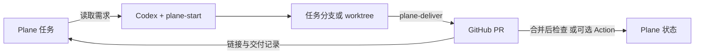

# Plane for Codex

一个社区维护的开源 Codex 插件，把 Plane 任务、开发分支、GitHub PR 和交付记录串起来。

第一版面向 **已有 Plane 任务 → Codex 开发 → PR → Plane 回写**。每个仓库有自己的项目映射，支持个人账号和组织仓库。Python 脚本只使用标准库；不需要为插件部署服务。

## 基本使用

在目标代码仓库的 Codex 聊天中，选择 **Plane for Codex**，说一句 **“初始化”** 即可。

插件会复用登录连接、读取工作区、结合当前仓库匹配项目，默认采用基础模式和人工验收。项目无法明确匹配时，它会列出项目让你选择。首次未连接账号时，在浏览器中完成授权；无需编写配置提示词或查找 UUID。

后续可以继续通过插件描述任务，也可以选择具体 Skill：

| 入口 | 示例 | 结果 |
| --- | --- | --- |
| `$plane-for-codex:plane-setup` | 初始化 | 复用或连接账号，匹配项目，自动解析状态和生成仓库映射 |
| `$plane-for-codex:plane-start` | 开始处理 DEMO-12，按任务要求实现并检查 | 读取需求，创建或续接任务分支，回写开发中 |
| `$plane-for-codex:plane-deliver` | 把当前任务提交为 PR，并回写交付结果 | 提交预期改动，推送、创建或更新 PR，回写链接和验收情况 |

`@` 选择插件，`$` 选择具体 Skill。插件入口取决于 Codex 版本；这些命令可直接在聊天输入框使用。v0.1 没有独立的插件配置页面，初始化通过对话、浏览器授权和仓库配置完成。



## 安装

需要支持插件的 Codex、Git、Python 3.10+；PR 操作需要已登录的 GitHub CLI (`gh auth login`)。开发版本已在 Codex CLI 0.162.0 上验证安装。

下载或 clone 本仓库后，使用其**绝对路径**：

```sh
codex plugin marketplace add /absolute/path/to/plane-for-codex --json
codex plugin add plane-for-codex@plane-for-codex --json
codex mcp login plane
```

Plane 在浏览器中处理授权，选择与目标项目一致的工作区。新装插件若未在当前聊天中出现，请新开该代码仓库的聊天加载插件。已有 `plane` MCP 配置时先检查冲突，不要覆盖其他连接。

然后在业务仓库中选择插件，说“初始化”。Codex 负责解析参数、生成 `.plane-for-codex.json`，并在已授权范围内处理配置提交/PR。映射合并到目标基础分支后即可开始任务。配置只保存工作区、项目、状态、仓库和完成规则，不保存凭证。完整字段见 [配置示例](examples/plane-for-codex.example.json)。

## 两种连接方式

| 模式 | 需要什么 | 能做什么 |
| --- | --- | --- |
| 基础模式，默认 | Plane MCP 浏览器授权；现有 GitHub 登录；每仓库项目映射 | 在 Codex 内读任务、开始开发、交付 PR 和回写。PR 合并后，在 Codex 中再次要求检查并同步 |
| 可选 GitHub 事件同步 | 基础模式 + Plane PAT + 仓库 Secret + 一次配置 PR | Codex 关闭后，GitHub Action 仍能随 PR 事件更新 Plane |

基础模式**不需要 Plane API key，不要求付费集成**。具体 API/MCP 权限仍以使用者的实际账户为准；若服务返回套餐或权限限制，插件报告失败，不会升级套餐。免费账户的真实读取和写入应分别验证。

GitHub Action 和本地 Codex 分别运行。浏览器 OAuth 不会自动变成 GitHub 的凭证。Setup Skill 能生成 Action 调用文件，辅助安全录入 Secret；使用者仍需在 Plane 创建 PAT。PAT 通过隐藏终端输入或 GitHub Secrets 页面录入，勿发送到聊天。

开源发布后，使用者把 Action 固定到该发布仓库的完整 commit SHA，例如 `owner/plane-for-codex@<40-character-sha>`。具体操作见 [setup reference](plugins/plane-for-codex/references/setup.md)。仓库中提供的 Action 已实现，但在未发布、未配置 Secret 前不会运行。

## 完成规则

- `manual`（默认）：代码合并后仍待人工验收，用户明确接受后由 Codex 回写 Done。
- `on_merge`：主任务 PR 合并到配置的基础分支后，可回写 Done。
- 任务有 `manual-acceptance` 标签时，总是等待人工验收。
- 关闭未合并的 PR 不会完成任务；已完成或取消的任务不会被同步重新打开。

v0.1 约定一条任务对应一个主 PR。多 PR、多仓库任务需要拆分或明确验收，再启用自动完成。重复执行续接已有分支和 PR；同步评论使用稳定 ID 更新。

## 无账号演示与验证

```sh
python3 plugins/plane-for-codex/scripts/plane_workflow.py demo
python3 -m unittest discover -s tests -v
```

演示使用临时目录中的真实 Git 仓库，生成任务分支和 PR 正文，并用内存 Plane 数据测试 PR 打开、合并、重复事件、人工验收规则。它不会创建真实 GitHub PR，也不会操作真实 Plane。输出包含 `result.json`、`pull-request.md` 和临时 Git 仓库。

## 第一版边界

现在包含三个 Skill、官方 Plane MCP 配置、仓库映射脚本和可选 PR 同步 Action。脑暴批量建任务、发布版本关联、主动任务队列、后台常驻服务、多 PR 聚合完成规则暂留后续版本。

这个插件是社区项目，与 Plane/OpenAI 没有官方隶属关系。凭证由使用者自己的 Codex/GitHub 保存，插件不会提供统一账户。发布步骤见 [PUBLISHING.md](PUBLISHING.md)；实现边界见 [架构说明](docs/architecture.md)。MIT License。

## English quick start

Plane for Codex is a community plugin linking existing Plane work items to task branches and GitHub PRs. Install the local marketplace with the commands above, then select **Plane for Codex** in your application repository and say **"set up"**. Onboarding reads the connected workspace, resolves the project from repository/context, and defaults to basic mode with manual acceptance. Complete browser consent if needed; choose a project only when matching is ambiguous. Use **Plane · Start** to implement a task and **Plane · Deliver** to create/update its PR and write back the delivery report. Codex prefixes installed Skill names with `plane-for-codex:` as shown in the table above.

Basic mode uses official Plane MCP OAuth and your existing GitHub CLI login. Optional event synchronization ships as a pinned GitHub Action and needs a separate Plane PAT in a repository Secret. Configuration is per repository; credentials are never stored in the mapping. Default completion requires manual acceptance. The offline demo makes no external service calls.
