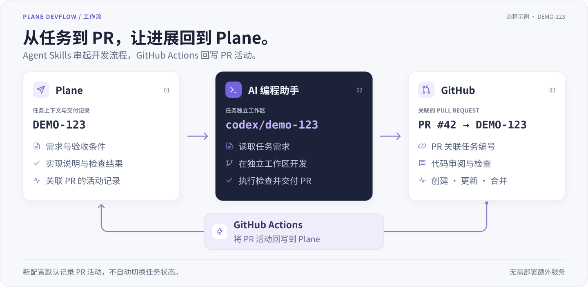

<p align="center">
  
</p>
<h1 align="center">Plane DevFlow</h1>
<p align="center">
  <a href="https://github.com/SoaringLabs/plane-devflow/releases"></a>
  <a href="https://github.com/SoaringLabs/plane-devflow/stargazers"></a>
  <a href="https://github.com/SoaringLabs/plane-devflow/actions/workflows/validate.yml"></a>
  <a href="LICENSE"></a>
  <a href="CONTRIBUTING.md"></a>
</p>
<p align="center"><a href="README.md">English</a> · <strong>简体中文</strong></p>
<p align="center"><strong>连接 Plane、AI 编程助手与 GitHub。</strong><br>开发任务、交付 PR、回写进展，无需 Plane 付费集成。</p>
<p align="center"><a href="#功能">功能</a> · <a href="#快速开始">快速开始</a> · <a href="#技能入口">技能入口</a> · <a href="#文档">文档</a> · <a href="CHANGELOG.md">更新记录</a></p>
<p align="center"></p>

适用于 **Codex、Claude Code、Cursor、OpenCode** 的开源 Agent Skills，并提供对应接入指引。从 Plane 任务开始开发，交付关联 PR，再通过 GitHub Actions 将 PR 活动回写到 Plane。无需部署额外服务。

## 功能

| 你可以做什么 | 能得到什么 |
| --- | --- |
| **连接 Plane 与 GitHub** | 将任务关联到主 PR，通过 GitHub Actions 回写 PR 活动，无需 Plane 付费 GitHub 集成 |
| **让 agent 按任务开发** | 提供任务编号，agent 读取需求，准备任务专属目录与分支 |
| **在 Plane 跟进交付** | 在任务中查看关联 PR、实现说明、实际检查结果与待验收项 |
| **同时推进不同任务** | 各任务在独立工作区开发，换聊天后恢复对应的任务版本 |
| **从零准备项目** | 从仓库准备、Plane 关联到同步配置，再审阅首批任务清单，确认后创建 |
| **诊断任务状态** | 只读汇总任务目录、检查、PR/CI、回写与待收尾项，分别说明证据和未知状态 |
| **验收后再决定合并** | 按需运行任务版本，获取可用入口与测试步骤；验收与合并分别确认 |

新配置会记录 PR 活动，**默认不自动切换任务状态**。配置方式与已有集成的处理见 [GitHub 同步](#github-同步)。

## 快速开始

### 安装

下面的 stable 渠道命令需要已有正式产品版本，并已激活 `stable` 分支。两者就绪前，请使用[安装说明](docs/installation.md)中的候选版本测试方式。

在目标代码仓库根目录执行，并选择你的 agent：

```sh
npx skills add https://github.com/SoaringLabs/plane-devflow/tree/stable \
  --skill plane-setup plane-start plane-deliver
```

该命令将三个技能安装到当前项目。添加 `--global` 可跨项目使用。环境要求、指定宿主、MCP 配置及 Codex 插件分发方式见 [安装说明](docs/installation.md)。

### 关联 → 开发 → 交付

在**目标代码仓库新开一个 agent 会话**。将 `PROJECT-123` 替换为你的任务编号。

| 步骤 | 对 agent 的请求 | 应看到的结果 |
| --- | --- | --- |
| 关联 | “使用 plane-setup 关联当前仓库与 Plane，并配置 GitHub 同步” | 已关联的项目与同步验证结果，或具体待完成步骤 |
| 开发 | “使用 plane-start 开始 PROJECT-123” | 任务专属目录、分支、需求与验收范围 |
| 交付 | “使用 plane-deliver 交付 PROJECT-123，先不要合并” | 关联 PR、验证报告与待验收项 |

需要试用时，可以说：**“帮我运行 PROJECT-123 的任务工作区代码，我来验收。”** Agent 会按照项目的运行或构建说明准备环境，核对代码版本，再交接可用入口。详见 [验收环境交接](skills/plane-deliver/references/acceptance-environment.md)。

**还没有仓库或任务？** 先看 [首次项目引导](docs/first-project.zh-CN.md)。已有项目可说：“使用 plane-start 规划第一版，先给我看任务清单，不要创建。”审阅具体清单后，再要求创建任务。详见 [任务规划](skills/plane-start/references/task-planning.md)。

每个仓库首次执行 setup，通过 `.plane-devflow.json` 保存项目关联。该映射需要先进入配置的基础分支，再创建独立任务分支。安装技能不会直接完成账号授权或激活 GitHub 同步；setup 会逐步验证，并复用已有连接。

### 分支前缀与切换 agent

新任务按当前 agent 使用分支前缀：Codex 使用 `codex/`，Claude Code 使用 `claude/`，Cursor 使用 `cursor/`，OpenCode 使用 `opencode/`。新配置默认不设置 `github.branch_prefix`，因此用 Codex 初始化项目不会将后续任务固定为 `codex/`。显式设置的 `github.branch_prefix` 优先于这些默认值。已有项目会保留固定前缀；需要启用自动选择时，删除该字段，并将配置改动合入基础分支。

同一任务换 agent 继续时，先停止上一会话的工作，再打开已记录的 worktree，沿用原分支和主 PR。例如 Claude Code 接续 `codex/project-123` 上的任务时，仍使用这个分支。在同一台机器上，拥有目录访问权限的 agent 可以直接看到未提交改动。详见 [agent 命名与串行接续](skills/plane-start/references/parallel-tasks.md#agent-naming-and-serial-continuation)。

## 技能入口

使用当前宿主的技能菜单，或按名称请求使用技能。调用方式、MCP 配置与实测边界见 [agent 兼容说明](docs/agent-compatibility.md)。

| 技能 | 什么时候用 |
| --- | --- |
| **Set Up Plane** — `plane-setup` | 关联仓库、配置 GitHub 同步，或继续未完成的初始化 |
| **Start Plane Task** — `plane-start` | 规划首批任务、创建已确认的清单，或开始、恢复已有任务 |
| **Deliver Plane Task** — `plane-deliver` | 交付或诊断任务 PR、准备试用、记录验收，或按授权收尾 |

Codex 独立技能使用 `$plane-setup`，Codex 插件使用 `$plane-devflow:plane-setup`；Claude Code 使用 `/plane-setup`；OpenCode 通过原生工具加载技能。选择一种分发方式，避免重复入口。每个技能均自带运行脚本与参考文件，也可单独安装。

## GitHub 同步

**默认使用 GitHub Actions：** 关联 PR 的事件会回写到 Plane，无需保持 agent 会话运行，也无需 Plane 付费 GitHub 集成或额外部署服务。

| 方式 | 需要准备 |
| --- | --- |
| **GitHub Actions（默认）** | 将 Plane PAT 存入仓库 Secret `PLANE_API_KEY`，并将映射与同步文件合入默认分支 |
| **Plane 官方 GitHub 集成（可选）** | 已启用并核对仓库、项目映射及规则；无需本插件的 workflow 或 PAT Secret |

关联项目使用浏览器授权；Actions 使用单独的 PAT。请直接在 GitHub Secrets 或由本人操作的隐藏终端输入中录入，不要发送到聊天。可选的 [本机凭据复用](skills/plane-setup/references/local-credentials.md) 使用 macOS Keychain 或 Windows Credential Manager。在 macOS 上，明确授权后的[自动创建与保存](skills/plane-setup/references/local-credentials.md#automatic-creation-from-plane-app)可复用 Plane App 的有效登录态，无需复制 PAT；会话过期时会提示先登录。

初始化中断或条件不足时会保存进度，之后可继续。**连接验证、观察到真实 PR 事件运行、确认任务回写是三份独立证据。** 日常远程元数据检查最多每 24 小时一次，失败也进入冷却；证据过期会明确提示，不自动触发连接测试。任务诊断默认只读本地记录和缓存，明确要求刷新时才读取当前远程事实。 新映射记录 PR 活动，默认不切换任务状态；旧映射沿用既有规则，原生集成的状态变化由官方集成控制。详见 [初始化与同步](skills/plane-setup/references/setup.md)。

## 使用范围

当前支持首版任务草案与确认后创建、已有任务开发、一条任务对应一个主 PR、Plane Cloud 和 github.com。通用任务/Cycle/Module 管理、自定义状态规则、多 PR 聚合、完整的自托管 Plane 与 GitHub Enterprise 接入暂不支持。

本地任务记录可在宿主提供可信上下文时支持换聊天恢复。跨机器会话与聊天记录迁移由宿主 agent 提供。已实现能力、验证深度和剩余边界见 [能力与证据清单](docs/capabilities.md)。

## 更新与移除

### 更新

对 agent 说：**“使用 plane-setup 升级当前仓库的 Plane DevFlow，先展示目标版本、changelog 和改动计划。”** 技能与公共 GitHub Action 使用同一个产品版本；升级流程沿用原安装渠道，协调本地刷新、项目升级 PR、激活和验证。

仅刷新技能文件时，重新执行安装命令：

```sh
npx skills add https://github.com/SoaringLabs/plane-devflow/tree/stable --skill '*'
```

原来是全局安装则添加 `--global`，刷新后新开 agent 会话。仅刷新文件不会更新项目的 Action 引用。只更新已安装技能、插件交接、恢复和回滚见[安装说明](docs/installation.md#update-or-remove-standalone-skills)。

### 移除

在原安装仓库中执行，并选择目标 agent：

```sh
npx skills remove plane-setup plane-start plane-deliver
```

全局安装添加 `--global`。移除技能会保留 MCP 连接、账号授权、项目映射、已复制的同步文件和任务工作区。Codex 插件的移除方式见[安装说明](docs/installation.md#install-the-codex-plugin-locally)。

## 文档

| 想了解什么 | 文档 |
| --- | --- |
| 第一个项目 | [新电脑准备、恢复交接与首批任务](docs/first-project.zh-CN.md) |
| Agent 兼容 | [Codex、Claude Code、Cursor、OpenCode](docs/agent-compatibility.md) |
| 安装、更新与移除 | [安装、更新及移除](docs/installation.md) |
| 初始化与恢复 | [项目关联与同步](skills/plane-setup/references/setup.md) · [中断后继续](skills/plane-setup/references/recovery.md) |
| 任务诊断 | [只读任务状态与部分完成情况](skills/plane-deliver/references/task-diagnostics.md) |
| 能力与证据 | [当前清单与验证边界](docs/capabilities.md) |
| 开发与交接 | [任务执行](skills/plane-start/references/task-execution.md) · [并行任务](skills/plane-start/references/parallel-tasks.md) · [验收环境](skills/plane-deliver/references/acceptance-environment.md) |
| 配置格式 | [基础映射](examples/plane-devflow.basic.json) · [旧映射](examples/plane-devflow.example.json) |
| 贡献与发布 | [贡献指南](CONTRIBUTING.md) · [架构](docs/architecture.md) · [发布指南](PUBLISHING.md) · [更新记录](CHANGELOG.md) |

在源码目录运行离线演示，无需账号，也不会调用真实服务：

```sh
python3 plugins/plane-devflow/scripts/plane_workflow.py demo
```

插件运行时的 Python helper 仅使用标准库。开发检查与决策评测见 [CONTRIBUTING.md](CONTRIBUTING.md)。

---

由 [SoaringLabs](https://github.com/SoaringLabs) 社区维护，与 Plane / OpenAI 无官方隶属关系。采用 [MIT License](LICENSE)。
