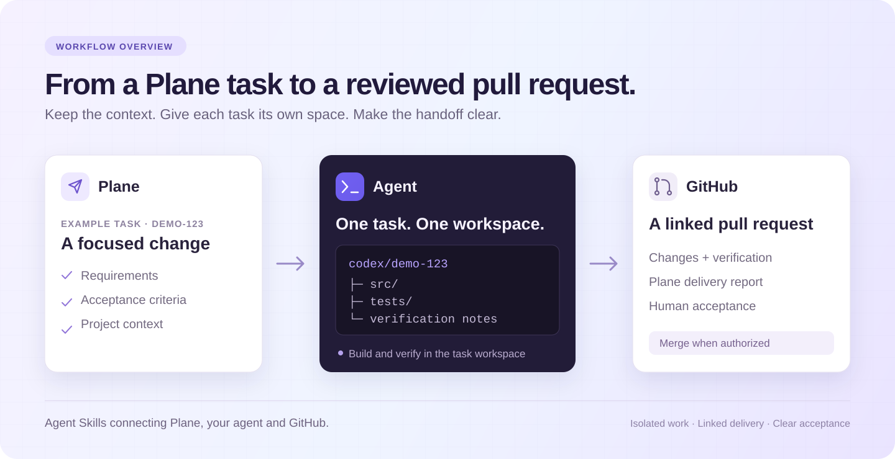

<p align="center">
  
</p>
<h1 align="center">Plane DevFlow</h1>
<p align="center">
  <a href="https://github.com/SoaringLabs/plane-devflow/releases"></a>
  <a href="https://github.com/SoaringLabs/plane-devflow/stargazers"></a>
  <a href="https://github.com/SoaringLabs/plane-devflow/actions/workflows/validate.yml"></a>
  <a href="LICENSE"></a>
  <a href="CONTRIBUTING.md"></a>
</p>
<p align="center"><a href="README.md">English</a> · <strong>简体中文</strong></p>
<p align="center"><strong>从 Plane 任务，到可审阅的 Pull Request。</strong><br>独立开发，衔接上下文，交付清晰可查。</p>
<p align="center"><a href="#快速开始">快速开始</a> · <a href="#功能">功能</a> · <a href="#技能入口">技能入口</a> · <a href="#文档">文档</a> · <a href="CHANGELOG.md">更新记录</a></p>
<p align="center"></p>

将 **Plane 任务、agent 开发和 GitHub PR** 串成一条工作流的开源 Agent Skills，提供 **Codex、Claude Code、Cursor、OpenCode** 的接入指引。从任务需求出发，在独立目录中开发，再交付附有验证与验收记录的关联 PR。无需部署额外服务。


## 快速开始

### 安装

在目标代码仓库根目录执行：

```sh
npx skills add SoaringLabs/plane-devflow \
  --skill plane-setup plane-start plane-deliver
```

Skills CLI 从 GitHub 将三个自包含技能安装到当前项目，并让你选择目标 agent。如需跨项目使用，可自行添加 `--global`。需要直接指定时，可加 `--agent codex`、`--agent claude-code`、`--agent cursor` 或 `--agent opencode`。需要 [Node.js 22.20+](https://nodejs.org/)、npm、Git，以及支持本地终端与 MCP 的 agent；运行辅助脚本需要 Python 3.10+，PR 操作还需要已登录的 [GitHub CLI](https://cli.github.com/)。

在**目标代码仓库新开一个 agent 会话**，选择或请求使用 **plane-setup**，按引导连接 Plane 并选择项目。每个仓库通过自己的 `.plane-devflow.json` 保存 Plane 项目关联；每个仓库首次运行 setup，之后复用该映射。全局安装只改变技能的可用范围。技能安装、MCP 注册、浏览器授权与 GitHub 后台同步分别确认；已有连接和授权会复用。工具缺失时见 [MCP 配置](docs/installation.md#plane-mcp-connection)。

Codex 插件使用 `$plane-devflow:plane-setup` 调用标识，详见 [本地插件安装](docs/installation.md#install-the-codex-plugin-locally)。选择一种分发方式，避免同时出现重复入口。

从 **Plane for Codex** 升级？请先查看 [0.10.0 升级边界](docs/installation.md#upgrade-from-the-previous-name)：配置路径与运行标识已变更，业务记录不会自动迁移。

### 开始第一条任务

下面的 `PROJECT-123` 是示例，请替换为项目中已有任务的真实编号。

| 步骤 | 对 agent 的请求 | 应看到的结果 |
| --- | --- | --- |
| 关联 | 使用 **plane-setup** | 已关联的项目，以及同步验证结果或具体待完成步骤 |
| 开发 | “使用 plane-start 开始 PROJECT-123” | 任务专属目录、分支、需求与验收范围 |
| 交付 | “使用 plane-deliver 交付 PROJECT-123，先不要合并” | 关联 PR、实际检查结果和待验收项 |

初始化生成的 `.plane-devflow.json` 需要先进入配置的基础分支，才能创建独立任务分支。仅核对需求时，可以明确要求“只讨论，不保存文件”。交付、验收与合并各按请求范围执行，已有授权会复用。

## 功能

| 能力 | 带来的帮助 |
| --- | --- |
| **任务独立工作区** | 每个任务使用独立目录与分支，保留主目录和其他任务的改动 |
| **恢复正确版本** | 再次开始或换聊天时，恢复该任务记录的目录与上下文 |
| **关联 PR 交付** | 一条任务对应一个主 PR，在 Plane 中保留实现与验证报告 |
| **按需准备试用** | 需要时运行任务版本，提供可用入口与测试步骤 |
| **GitHub 后台同步** | 通过 Actions 或已配置的 Plane 官方集成记录 PR 事件 |
| **清晰的验收与完成** | 区分运行就绪、人工验收与合并授权 |

交付后可说：“帮我运行 PROJECT-123 的任务工作区代码，我来验收。”Agent 会依据项目自身的运行/构建说明准备入口，核对实际来源版本，再交接测试。只交付 PR 不会强制启动环境。详见 [验收环境交接](skills/plane-deliver/references/acceptance-environment.md)。

## 技能入口

使用当前宿主的技能菜单，或按名称请求使用以下工作流。Codex 使用 `$plane-setup`；Claude Code 使用 `/plane-setup`；OpenCode 通过原生 skill 工具加载。调用方式、MCP 配置与实测边界见 [agent 兼容说明](docs/agent-compatibility.md)。

| 入口 | 什么时候用 |
| --- | --- |
| **Set Up Plane** | 关联项目，检查或调整映射，继续同步配置 — `plane-setup` |
| **Start Plane Task** | 讨论、规划、开始或恢复已有任务 — `plane-start` |
| **Deliver Plane Task** | 交付 PR、准备试用、记录验收或按授权收尾 — `plane-deliver` |

推荐命令一次安装三个阶段：**关联 → 开发 → 交付**。保留独立入口，方便按当前任务调用对应阶段。每个技能自带运行脚本与参考文件；只需要部分流程时，也可以按名称单独安装。Codex 插件的调用标识使用 `$plane-devflow:` 前缀。

## GitHub 同步

| 方式 | 需要准备 |
| --- | --- |
| **GitHub Actions（默认）** | 单独的 Plane PAT，存入仓库 Secret `PLANE_API_KEY`；同步文件需要合入默认分支 |
| **Plane 官方 GitHub 集成** | 已启用并核对仓库、项目映射及规则；无需本插件的 workflow 或 PAT Secret |

关联项目使用浏览器授权，不需要 PAT。Actions 的 PAT 请直接在 GitHub Secrets 或由本人操作的隐藏终端输入中录入，不要发送到聊天。

初始化中断或条件不足时会保存进度，之后可继续。**连接验证通过与真实 PR 事件回写成功会分别报告。** 新基础映射记录 PR 活动，保留任务状态；旧映射沿用既有规则，原生集成的状态变化由官方集成控制。详见 [初始化与同步](skills/plane-setup/references/setup.md)。

## 使用范围

当前支持已有任务、一条任务对应一个主 PR、Plane Cloud 和 github.com。Cycle/任务管理、自定义状态规则、多 PR 聚合、完整的自托管 Plane 与 GitHub Enterprise 接入暂不支持。

## 更新与移除

再次执行安装命令即可刷新这三个技能。GitHub 来源有完整追踪记录时，也可使用 Skills CLI 的更新检查：

```sh
npx skills check
npx skills update plane-setup plane-start plane-deliver --project
```

在同一仓库执行 `npx skills remove plane-setup plane-start plane-deliver` 并选择目标宿主，即可移除项目技能。已有全局安装在更新时将 `--project` 换成 `--global`，移除时添加 `--global`。更新后新开聊天。移除技能会保留 MCP 连接、账号授权、业务映射、已复制的同步文件和任务工作区。本地插件安装及移除见 [安装说明](docs/installation.md)。

## 文档

| 想了解什么 | 文档 |
| --- | --- |
| Agent 兼容 | [Codex、Claude Code、Cursor、OpenCode](docs/agent-compatibility.md) |
| 安装、更新与移除 | [安装、更新及移除](docs/installation.md) |
| 初始化与恢复 | [项目关联与同步](skills/plane-setup/references/setup.md) · [中断后继续](skills/plane-setup/references/recovery.md) |
| 开发与交接 | [任务执行](skills/plane-start/references/task-execution.md) · [并行任务](skills/plane-start/references/parallel-tasks.md) · [验收环境](skills/plane-deliver/references/acceptance-environment.md) |
| 配置格式 | [基础映射](examples/plane-devflow.basic.json) · [旧映射](examples/plane-devflow.example.json) |
| 贡献与发布 | [贡献指南](CONTRIBUTING.md) · [架构](docs/architecture.md) · [发布指南](PUBLISHING.md) · [更新记录](CHANGELOG.md) |

在源码目录运行离线演示，无需账号，也不会调用真实服务：

```sh
python3 plugins/plane-devflow/scripts/plane_workflow.py demo
```

插件运行时的 Python helper 仅使用标准库。开发检查与决策评测见 [CONTRIBUTING.md](CONTRIBUTING.md)。

---

由 [SoaringLabs](https://github.com/SoaringLabs) 社区维护，与 Plane / OpenAI 无官方隶属关系。采用 [MIT License](LICENSE)。
