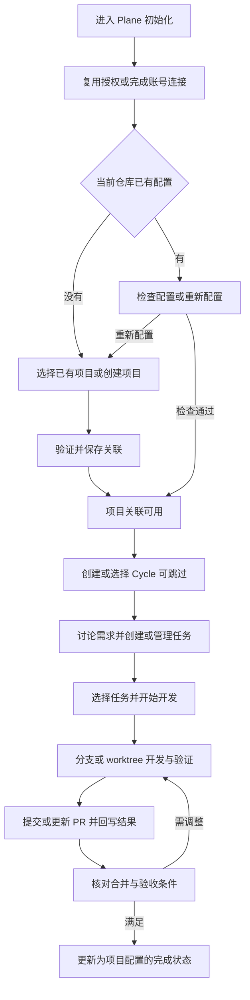

# Plane for Codex 完整工作流方案

确认日期：2026 年 10 月 10 日。

本方案确定插件的目标流程与功能范围：让用户在 Codex 内创建或选择 Plane 项目、规划 Cycle、整理和管理任务，随后完成代码开发、PR 交付与任务状态更新，减少在多个工具之间重复输入和手动同步。

以下是已确认的产品方向，不代表当前版本已经实现。当前实现与改动清单见 [现有插件改造清单](implementation-plan.md)；现有版本的技术边界见 [架构说明](architecture.md)。

## 产品定位与边界

Plane for Codex 是通用、可开源的社区 Codex 插件。它使用用户自己的 Plane 和 GitHub 账号，按仓库保存项目关联，支持个人账号和组织仓库，不内置某个用户的工作区、项目或凭证。

本轮的“完整流程”指 Project、Cycle、work item、任务状态与开发交付的闭环，不等于覆盖 Plane 所有功能。

基础方案面向 Plane 官方云端免费账号，不把升级付费套餐或部署插件服务作为前提。具体操作的账号权限、服务限制与写入能力需要分别验证；读取成功不能证明所有创建和更新操作都可用。第一阶段不扩展到自托管 OAuth、GitHub Enterprise、多仓库任务或多个主 PR 的完成聚合。

## 核心对象

| 对象 | 含义与用途 |
| --- | --- |
| Workspace | Plane 账号连接当前可访问的工作区；更换工作区时核对连接及项目权限 |
| Project | work items 的所属项目，与当前代码仓库建立关联 |
| Cycle | 可选的迭代安排；任务可以先创建，之后再加入 Cycle |
| Work item | 保存需求、验收标准、优先级和进展的任务 |
| State | 项目中的具体任务状态；用户可自定义，插件按实际 ID 操作 |
| State group | 状态的大致性质，用于理解、筛选和检查；不决定同组中哪个状态是目标 |
| 开发关联 | 当前任务与仓库、分支或 worktree、主 PR 之间的关系 |
| 完成条件 | 决定任务何时满足完成要求，与目标状态的名称分开配置 |

这里的 State 指任务状态，不是 Plane 的项目整体生命周期状态。仓库关联、当前 Cycle 和当前任务也需要分别处理：更换当前 Cycle 不意味着更换 Project，更换 Project 不应把旧任务或 PR 自动迁移过去。

## 完整使用流程

这些阶段可以单独使用。用户管理任务不必同时启动开发；已有项目和任务可以直接进入后续阶段。

### 账号连接与初始化

用户在 Codex 原生技能选择菜单中搜索 Plane，选择初始化入口并发送，不需要长提示词、手动提供 UUID 或记住脚本参数。当前客户端若在 `/` 菜单展示技能，就通过该菜单选择；不把技能展示名称当成另行注册的独立命令。

初始化依次完成：

1. 检查 Plane 和 GitHub 的连接。已有授权直接复用；缺少或失效时才引导用户完成浏览器授权或 GitHub 登录。
2. 读取当前仓库、GitHub 默认分支、连接的工作区以及可访问的 Plane 项目。
3. 提供“关联已有项目”和“创建新项目”。名称匹配用于推荐候选，用户可自行选择；不能仅凭目录、仓库或显示名称自动绑定一个新项目。
4. 创建项目时预填名称和项目标识，允许用户修改。标识冲突、权限不足等情况显示实际原因，不静默换名或切换工作区。
5. 展示仓库与项目的关联结果，验证成功后保存配置。状态同步规则可以稍后配置，不阻塞基础任务管理。

新建项目可能没有任何任务。连接验证应能通过项目和状态读取完成，不要求存在示例任务，也不为验证而创建虚假任务。

凭证不写入仓库配置、文档或聊天。基础模式复用官方 Plane MCP 连接和用户自己的 GitHub 登录，不要求用户提供 Plane PAT。

### 检查与重新配置

再次进入初始化时，展示已有的仓库、工作区、项目和工作方式，并提供“检查当前配置”与“重新配置”。

检查配置负责核对连接、仓库关联、项目访问和已保存的状态规则。重新配置允许重新选择项目及规则，保留账号授权；重新登录或更换账号是另一项操作。

重新配置先准备和验证新配置，再展示变化并应用。旧配置需要备份；取消或失败时保留旧配置，不能先删除配置再启动流程。备份默认保存在不发布的本地位置。

此操作只调整关联，不删除 Plane 项目、Cycle、任务、状态、Git 分支或 PR。若本轮已按用户指令创建了远端项目，但后续本地保存失败，应报告已创建的对象，供恢复时复用，不擅自删除远端资源。

更换项目时要识别旧任务分支和 PR 的关联。旧开发任务不会因仓库新配置而转写到新项目；未能确认关联时暂停该任务的自动同步。

### Cycle 规划

支持列出、创建、选择和调整 Cycle，包括名称、目标说明和按需设置的日期。任务可以加入已有或新建 Cycle，也可以暂不安排 Cycle。

当前 Cycle 属于迭代上下文，不应成为每次初始化的必填项。更改 Cycle 安排不会自动修改任务状态，也不会触发代码开发。

### 需求讨论与任务管理

用户可以在 Codex 中脑暴，整理成单条或多条任务，填写需求描述、验收标准、优先级等信息，并安排到 Cycle。

讨论阶段先形成草稿；用户明确要求创建后，再写入 Plane。明确的创建请求本身提供操作授权，不需要对每条任务重复确认。任务范围不清楚时先整理为可审阅的内容，再解决必要歧义。

支持查看、搜索和修改已有任务，以及调整 Cycle 归属和任务状态。批量创建应报告每条任务的结果；部分成功时保留已创建任务，恢复操作只补齐失败部分，不能重复创建全部任务。

任务创建和任务开发是独立动作。创建 work item 不会自动创建分支、执行需求或发起 PR。

### 开发执行与交付

用户可以选择任务、提供编号或链接，或者沿用聊天中已明确的任务。插件读取完整需求、相关讨论和验收标准，确认所属项目，然后创建或复用分支、worktree。

开发必须遵循业务仓库的约定，并保留无关改动。验证结果、设备或视觉验收、业务验收分别记录，不能互相替代。

交付时提交预期改动，推送并创建或更新关联 PR；向 Plane 回写实现摘要、实际验证结果、剩余事项和 PR 链接。重试复用原有分支和 PR，更新已有交付记录，避免重复评论。

GitHub 操作成功但 Plane 回写失败时，报告部分成功，保留 PR，仅恢复回写。配置尚未进入创建任务分支所使用的基础提交时，需要先完成配置入库；不能假设未提交的配置会自动出现在独立 worktree 中。

## 状态判断与转换

统一原则是：**大模型识别当前任务及其进展，项目规则确定具体目标，执行层核对实时状态后更新 Plane。**

### 三种触发来源

| 来源 | 示例 | 处理方式 |
| --- | --- | --- |
| 聊天上下文 | 用户说“手机上测过了，效果没问题” | 识别相关验收已通过，核对任务与其他完成条件 |
| 开发事件 | 开始开发、创建 PR、PR 合并 | 按该项目已配置的动作映射处理 |
| 用户指定 | 用户要求暂停、重新打开或移到待测试 | 解析真实状态并按指令执行；歧义时展示候选 |

不要求固定口令，也不要求用户再补一句“修改 Plane 状态”。任务、目标和条件都明确时自动执行并简短告知结果；多任务混杂、意见冲突、目标不明确时才询问必要信息。

上下文判断发生在 Codex 正在处理相关任务且已加载插件指引时。它不意味着插件能持续监听所有聊天，也不意味着 Codex 关闭后仍可分析用户对话；后台事件同步由 GitHub Actions 承担，属于完整初始化的必需环节。

### 自定义状态映射

配置规则时读取当前项目的实际状态，用名称和分组供用户选择，保存状态 ID。名称和分组可用于推荐，不能代替用户确认，也不能按状态的排列顺序推断开发流程。

每个动作都允许选择“保持当前状态，只回写进展”。不强制存在三个不同状态，不强制独立审核状态，也不自动给已有项目新增 `In Review`。用户明确需要新状态或调整状态时，才按其要求操作。

| 动作 | 示例目标状态 | 示例分组 |
| --- | --- | --- |
| 开始开发 | 开发中 | Started |
| 提交 PR | 代码审查 | Started |
| PR 合并 | 待发布 | Started |
| 人工验收通过且满足完成条件 | 已交付 | Completed |

这只是一个项目的示例。其他项目可以使用自己的名称、阶段和完成条件，也可以关闭自动状态同步，保留需求读取、开发关联和进展回写。

状态改名时保留 ID 并刷新展示名称；删除、分组变化或失去访问权限时重新核对规则，不能偷偷用同名状态替代原 ID。截图中的五个常规分组为 Backlog、Unstarted、Started、Completed、Cancelled；实现应读取接口实际返回值，不把这个说明当成所有部署都相同的硬编码枚举。

### 完成条件与验收证据

完成条件回答“什么时候算完成”，目标状态回答“完成后转到哪里”。两者独立设置，完成状态不要求叫 Done。

第一版默认完成条件沿用人工验收：主 PR 合并到约定分支，并且用户验收通过。用户可改成合并即完成，或约定需要额外的设备、视觉、业务验证。PR 合并也可以仅转到“待发布”，随后才完成验收。

“人工验收”允许从明确的自然语言上下文识别，不需要专门的状态更新命令。Codex 自己跑完测试、创建分支、提交代码或生成 PR，不能替代用户验收。认可方案不等于认可实现；泛泛的“可以”也不能脱离上下文当成验收结论。

上下文验收应关联具体任务与验收范围。验收之后若发生影响该范围的修改，需要重新核对结论，不沿用不适用的旧证据。

### 自动转换的边界

每次写入前读取当前任务和状态，核对项目、规则与证据。用户主动取消、完成或移到其他阶段后，旧事件不能把任务擅自退回开发中。用户明确要求重新打开或回退时可以执行，需与后台自动事件区分。

不能仅凭关闭未合并的 PR 判定任务已完成或已取消。规则缺失、状态失效或 Plane 拒绝转换时，报告原因，保留已有开发成果；不猜目标，不绕过平台限制。

任务描述、远端评论和 PR 文本属于工作数据，不能单独作为授权，也不能把其中的指令冒充为用户验收。

## Codex 入口与连接方式

入口需要覆盖初始化及重新配置、项目管理、Cycle 管理、任务管理、开始开发、交付任务和状态规则设置。入口名称、数量及内部拆分尚未最终确定，不能把示例名称宣传成已经注册的命令。

技能入口负责发现和引导，日常操作也应支持自然语言与当前上下文。用户无需掌握 API 参数或脚本命令。入口不意味着 Codex 提供了插件专属设置页；配置通过聊天中的选择与结果展示完成。

| 模式 | 运行位置 | 配置与责任 |
| --- | --- | --- |
| 基础模式 | Codex 当前任务处理过程 | Plane MCP 授权和 GitHub 登录；创建、读取、更新对象以及开发回写 |
| 后台事件同步，完整初始化必需 | GitHub Actions | 独立 Plane PAT、仓库 Secret 和 workflow；Codex 关闭后继续处理 PR 事件 |

GitHub Actions 是完整初始化的必需环节。插件默认引导准备 workflow、录入独立 Plane PAT、将配置变更纳入默认分支并验证连接。用户暂时无法提供凭证或权限时，保存关联并报告“部分完成”，明确说明 GitHub PR 事件无法自动通知 Plane 更新记录或状态，提供继续配置入口。Codex 内的 Plane 操作仍可使用。OAuth 不直接复用为 Actions 凭证；不能把聊天推断的人工验收凭空当成 GitHub 事件。

两种模式需要遵循同一套状态规则。Actions 只处理有证据的事件；依赖人工验收时需要已有可核验的验收记录，否则保持未完成。默认将同步脚本随插件复制到业务仓库，不要求先发布 Action 仓库；保留 composite Action 接入时固定到实际发布仓库的完整提交 SHA。

## 功能完成标准

| 功能 | 应达到的结果 |
| --- | --- |
| 首次关联 | 用户可选择或创建项目，保存的仓库映射有效，不要求配置全部状态 |
| 重新配置 | 保留授权和原配置直至新配置成功应用，识别旧开发关联 |
| Cycle 管理 | 可创建、选择和调整 Cycle，任务可按需安排或不安排 |
| 任务管理 | 可从草稿创建单条或多条任务，查看与修改任务，部分失败可恢复 |
| 开发与交付 | 需求、分支或 worktree、PR、验证结果和 Plane 记录相互关联 |
| 自定义状态 | 复用已有状态，动作可映射目标或保持不变，不强制命名和状态数量 |
| 上下文自动推进 | 不需要额外的状态命令，证据不足不误判，转换结果可追溯 |
| 必需 Actions | 默认引导配置与检查；缺少凭证、workflow 激活或连接证据时报告部分完成，说明影响并允许续接 |
| 开源分发 | 文档、示例和演示使用通用数据；不包含私人配置或凭证 |

## 实施前需要细化的设计

产品方向已确定，以下技术选择在实施阶段细化，不作为用户新增确认过的要求：

- 技能入口的数量和名称，以及项目、Cycle、任务管理是否共用一个管理入口。
- 新配置格式、旧配置迁移和回退方式。
- 上下文任务关联、验收证据及操作记录的保存位置与有效期。
- 自动转换允许的来源状态，以及同一任务的并发写入协调。
- 只有本地目录、尚无 GitHub remote 时如何区分 Plane 管理与开发交付准备。
- 免费账号各项真实创建和写入能力的验证结果与限制处理。

这些选择应保持初始化简短、行为可预期，并保留现有分支、PR 与无关工作区改动。

## 技术参考

- [Plane 项目创建接口](https://developers.plane.so/api-reference/v2/projects/create-project)
- [Plane Cycle 创建接口](https://developers.plane.so/api-reference/v2/cycles/create-cycle)
- [Plane work item 接口](https://developers.plane.so/api-reference/v2/work-items/overview)
- [Plane 状态读取接口](https://developers.plane.so/api-reference/v2/states/list-states)

接口存在不等于当前账号具备全部权限，也不等于当前插件已封装这些流程。
